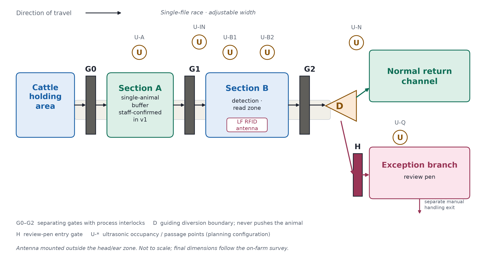
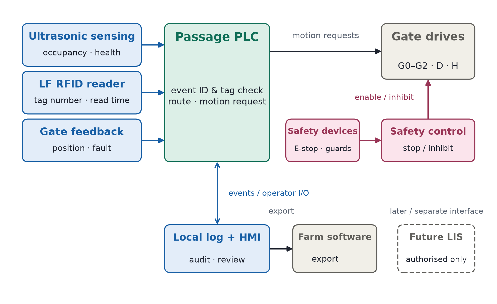

# ID-Coo — Cow Identity Verification and Anomaly Diversion System for Dairy Farms in Northern England

**Product Development and Marketing Report** · CW1HN015 Engineering & Law, Coursework 1 · Team: Members 1–5

| Item | Detail |
|---|---|
| Product | ID-Coo |
| Target region | Northern England |
| Target breed | Holstein Friesian |
| Status | Framework v1.0 (2026-10-14): R9/R10 final by Member 4; other sections placeholders |
| Submission | Cadmus — body text typed in directly (no paste); canvases uploaded to the group workspace |

> **使用说明 / How to use**: 组员在各节灰色指引行下的占位处直接写自己的终稿内容（英文）；R9/R10 已由组员4 定稿填入；指引行（负责人 / 篇幅上限 / 硬性要求）在定稿时删除；全文表格与图编号由组员5 拼稿时统一；价格三点 £18,500 / £720 / £60 全篇一致；引用只用 R13 表内编号。
> Members: write your final content directly under the guidance line of your section (English). Delete the guidance lines before submission. Figures/tables are numbered globally by Member 5 at assembly.

---

[Insert School's own header]

## Declaration of Originality Form

This form must be completed and signed and submitted with all assignments. Please complete the information below (using BLOCK CAPITALS).

| Information | Entry |
|---|---|
| Name | ____________________ |
| Student Number | ____________________ |
| Course Name | ____________________ |
| Assignment Number/Name | ____________________ |

I confirm that this assignment is my own work and that I have:

- [ ] Read and understood the guidance on plagiarism in the Student Handbook, including the University of Glasgow Plagiarism and Academic Integrity Code
- [ ] Read and understood guidance that is available on generative artificial intelligence (AI) by the University; by the School; and in relation to this specific piece of assessment
- [ ] Clearly referenced, in both the text and the bibliography or references, all sources used in the work
- [ ] Fully referenced (including page numbers) and used quotation marks for all text quoted from books, journals and online sources, in accordance with the School's accepted referencing style(s)
- [ ] Provided the sources for all tables, figures, legends, data, and code that are not my own work
- [ ] Ensured that I have not made use of any of my own work, or the work of any other student(s) past or present without acknowledgement
- [ ] Not sought or used the paid services of any external agencies, including plagiarism checkers or proofreading services
- [ ] Not used any website or software that generates assessment content without clearly acknowledging that I have done so
- [ ] Ensured that if use of generative AI is permitted in this assessment, I have clearly acknowledged its use, citing the specific tool(s) used and how they were used

**Generative AI use record:** ____________________ (tool, version, how it was used, and the author's own original contribution — to be completed truthfully by the submitter)

DECLARATION: I am aware of and understand the University's policy on plagiarism and academic integrity and I certify that this assignment is my own work, except where indicated by referencing, and that I have followed the good academic practices noted above.

Signed: ____________________　Date: ____________________

## Declaration of Contribution

| Member name & student number | Tasks actually undertaken | Verifiable evidence (drafts, minutes, Cadmus activity) | Completion & collaboration |
|---|---|---|---|
| Member 1 — ____________ | R1, R2, R3 + project coordination & minutes | ____________ | ____________ |
| Member 2 — ____________ | R4, R5, R6 + competitor evidence | ____________ | ____________ |
| Member 3 — ____________ | R7, R8 + market data consistency | ____________ | ____________ |
| Member 4 — ____________ | R9, R10 + figures & diagrams | ____________ | ____________ |
| Member 5 — ____________ | R11, R12, R13 + editing, IEEE, declarations, final assembly | ____________ | ____________ |

---

## 1. Determine the constraints for EID and regulations in relation to LIS

> *Cadmus Step 2 · Member 1 · 5% · half a page (~250 words) · ≥4 creditworthy constraints, each with its implication for the proposed system · sources must be government/industry documents (gov.uk, AHDB, ICAR), not blogs or vendor pages · use the updated Defra timeline (new traceability service planned for 2027; LF-EID for newborn calves from 2027) and note the correction of the brief's earlier wording · must be consistent with §10.6 (local export only, no claimed direct LIS connection)*

[To be written by Member 1]

## 2. What are the consequences of misidentification of dairy cows in farm environments

> *Cadmus Step 3 · Member 1 · 5% · half a page (~250 words) · ≥4 creditworthy cause-and-effect chains in the farm context · each chain must land on individual animals, milk collection, statutory traceability and/or human–animal safety · measures listed must map to the R9 requirements*

[To be written by Member 1]

## 3. Formulating the idea

> *Cadmus Step 4 · Member 1 · 10% · A3 canvas (photo or digital, must be legible) · Jobs / Pains / Gains × products & services / pain relievers / gain creators · strong fit between customer segment and value proposition · upload to the Cadmus group workspace · customer segment (frozen by the team): dairy farms in Northern England with existing handling facilities, electronic ear tags and a material verification burden; first validation cohort ~100–250 adult cows*

[Insert VPC canvas — A3, legible; upload to the Cadmus group workspace]

## 4. Identifying group membership and differentiation factors

> *Cadmus Step 5 · Member 2 · 10% · up to 1 page including 3 tables + conclusion (≈500 words of prose) · compare with competitors one by one · points of difference must be valuable to the customer · comparison set: manual checks / handheld RFID / fixed RFID / Arrowquip mechanical sorting / DeLaval sort gates / GEA DairyNet*

[To be written by Member 2 — 3 tables: POP / POD / honest limitations, plus a short conclusion]

## 5. More on competition analysis

> *Cadmus Step 6 · Member 2 · 5% · up to 2 pages (≤1,000 words) · no figures · at least two tools (SWOT / Porter's five forces / PESTEL / simple market analysis), each ending in a concrete product decision · conclusions must not contradict R4*

[To be written by Member 2]

## 6. Product/Service analysis and competition — unique selling point

> *Cadmus Step 7 · Member 2 · 5% · 1 sentence (~150 words total) · a specific, differentiated benefit clearly derived from the customer and competitor analysis · every design decision in §10 must trace back to this USP*

[To be written by Member 2]

## 7. Fill in the business canvas

> *Cadmus Step 8 · Member 3 · 10% · A3 canvas, legible, uploaded to the group workspace · all nine blocks, internally consistent · pricing block must carry the £18,500 / £720 / £60 figures · partners are proposed roles, not signed agreements*

[Insert BMC canvas — A3, legible; upload to the Cadmus group workspace]

## 8. Critical analysis

> *Cadmus Step 9 · Member 3 · 10% · up to 1 page, no figures · quantified market size + serviceable share (SAM) + customer/product alignment · note the GB producer count (≈6,850) is not the Northern England customer count — use the regional estimation method · state which farms should NOT be targeted · this is the only legitimate entry point for revising the concept; any change must be synced to Parts 1–3*

[To be written by Member 3]

## 9. User requirements and justifications

> *Cadmus Step 10 · Member 4 · 10% · up to 1 page · 10 requirements, all Must have · formulated as user needs (what, not how), individually justified and traceable · **FINAL — Member 4** (rewrite at least five entries in your own words before typing into Cadmus)*

The ten requirements below state what ID-Coo must do for the target farm. They are user needs, not design solutions — what must be achieved, not how (Section 10). Each is justified individually and traced to the constraints of Section 1, the consequences of Section 2 and the jobs, pains and gains of Section 3. All are **Must have** under the MoSCoW framework: each is a precondition of the value proposition and cannot be traded away in version 1.

| # | User requirement (what the system must do) | Justification and traceability |
|---|---|---|
| UR1 | Confirm the identity of every animal that carries a compatible, working electronic ear tag | Mis-bound records corrupt treatment, yield and breeding data and weaken milk-buyer controls (§2); reliable identity correspondence is the customer's core gain (§3) |
| UR2 | Hold every animal whose identity cannot be confirmed in a managed review process | Tags are lost, damaged or unreadable (19.8% cumulative over five years [6]); an unidentified animal must not silently re-enter the herd or be recorded under a guessed identity |
| UR3 | Never process two or more animals passing together as a single animal | Cows bunch through handling gates and can yield two IDs at once; binding a neighbour's number to the current animal is a direct cause of misidentification (§2) |
| UR4 | Let staff operate, stop and safely take over the system from outside the race | Cattle handling carries injury and stress risk [8]; version 1 depends on staff confirming single-animal entry, so external control is a precondition of safe use |
| UR5 | Keep every reading bound to the animal that produced it, and confirm the exit actually taken | A delayed result must never act on the next animal, and a correct reading must never divert the wrong cow — both are documented failure paths (§2) |
| UR6 | Preserve passage and exception records when the network is unavailable | Farm connectivity is unreliable; records must survive outages so verification and reporting can be completed later (§3: scattered records) |
| UR7 | Provide auditable identity, time and outcome records without misreporting legal movements | Statutory duties include updating the holding register within 36 hours and reporting movements within 3 days [4], [5]; internal passage through the race must never be filed as a farm movement |
| UR8 | Handle the agreed throughput without unacceptable queuing | Keeping passage smooth is a stated customer job (§3); the trial target is 200 head within 90 minutes, counting re-reads and routine reviews |
| UR9 | Keep operating in the farm environment — wet, dirty, cold, corrosive — after routine cleaning | Robustness, reliability and maintainability in the actual barn are stated product requirements (§1); equipment must suit real conditions, not only the laboratory |
| UR10 | Match total cost of ownership with verified economic benefit | Affordability is a stated requirement: price must be justified by value for money, evidenced by measured rather than claimed labour savings (§12) |

UR1 acceptance reports confirmed-read accuracy and coverage separately: high accuracy on confirmed reads does not demonstrate adequate identification while many animals remain unresolved.

## 10. Technical description of the solution

> *Cadmus Step 11 · Member 4 · 10% · up to 4 pages including ≤2 figures (each counts as half a page) · full chain: physical structure → equipment → circuit → algorithm → data & farmer UI → LIS interface → pricing · aligned with the user requirements, the product and the price point · **FINAL — Member 4** (follow the rewrite prompts in the entry worksheet before typing into Cadmus)*

*Prepared for the line manager. Version 1 is a concept design: staff confirm single-animal entry from outside the race; the system then reads, decides and diverts automatically. Nothing below is yet validated on farm — Section 10.7 defines what must be proven before sale. Figures 1 and 2 show the functional layout and control structure; neither is a construction drawing.*

### 10.1 Physical structure

Animals travel through a single-file race: holding area → gate G0 → buffer section A → gate G1 → detection section B → gate G2 → diversion area with gate D (Figure 1). Interlocked gates keep one animal at a time in the read zone. After reading, gate D selects one of two exits: the normal return channel, or the exception branch through pen gate H to the review pen. All animals leave B moving forward; D forms a guide boundary only and never pushes or squeezes an animal.

Version 1 uses one buffer and one detection section; extra forward sections add waiting capacity, not throughput, and add gates and failure points. Adjustable commercial alleys (≈526–800 mm wide, 8 ft and 10 ft modules) indicate the structural envelope [13], [14]. Section length, clear width and antenna height follow CIGR standard dimensions for the target breed — adult Holstein–Friesian dairy cows: ≈1.4 m withers height (CIGR standard 1.44 m in the 650–749 kg class [26]; field average 1.41 m from 1,054 Holstein–Friesian cows [27]), body length ≈1.71–1.75 m and chest width ≈0.60 m [26], [27]; another breed later means re-parameterising from the same tables, not redesigning. Final dimensions and door swings come from the on-farm survey, and module length is never assumed to equal one animal's length. (UR8, UR9)

The review pen is a temporary holding area for manual verification, not a disease-isolation facility. It has an independent entry with anti-return control and a separate manual handling exit; gate H closes only after an animal has fully passed, and when the pen is full or the branch is blocked, intake stops and upstream pauses. Capacity follows C ≥ λq × th + Cm (anomaly rate × handling interval + margin) — an average-load relation that does not cover consecutive anomalies, so full-pen monitoring stays mandatory. The budget scenario reuses an existing pen of about six head; as a design floor, a sorting pen should hold at least one side of the milking parlour, with water, feed and lying space [26].

### 10.2 Sensing equipment and capability boundaries

Two sensing modalities are used, each with a declared boundary (table below). A low-frequency RFID reader (ISO 11784/11785, HDX and FDX-B; Tru-Test XRP2/XRP2i as functional reference, final model by site survey) reads the statutory electronic ear tag through an antenna mounted outside the head/ear zone of section B [11], [12].

Six ultrasonic points (U-A, U-IN, U-B1, U-B2, U-N, U-Q) monitor occupancy and passage: distance d = c·Δt/2 is judged against a baseline captured with the race empty, and every point reports *empty*, *occupied* or *uncertain* — no echo, stale data or a device fault means uncertain, never empty, and one echo peak is never counted as one animal [15]. Sensors are evaluated for manufacturer-supported time-shifted transmission to limit crosstalk [16].

| Subsystem | Function | Capability boundary |
|---|---|---|
| Mechanical separation | Creates the single-animal space; blocks following animals | Does not prove the read zone is free of neighbouring animals |
| Ultrasonic sensing | Occupancy, entry/exit, suspected following | Cannot identify an animal or prove animal count |
| RFID | Reads the electronic tag number | Cannot prove the tag is intact, or why a read failed |
| Gates and diversion | Execute confirmed passage and exit choice | No diagnosis; no official identity decision |
| Manual review | Checks tags, reconciles records | Never guesses identity from queue order [3] |

Mechanical separation does not separate radio read zones: even with one animal in B, the antenna may pick up a neighbour's number, so read attribution is tested explicitly (10.7). A cracked tag housing with a working chip, or a missing non-electronic tag, needs visual inspection. (UR1–UR3, UR9)

### 10.3 Control hardware, electrical and safety

Concept electrical structure: site supply → isolation, protection and distribution → drive circuits and control supply; sensors and gate-position feedback wire to the PLC; e-stop, obstruction and guarding devices wire to an independent safety chain (Figure 2). The PLC *requests* gate motions; the safety chain alone *permits* a drive, and software cannot bypass it.

Safety-related control functions are specified by risk assessment following ISO 13849-1 — citing the standard claims no achieved performance level [25]. Drives report open, closed, locked and fault positions. Anti-pinch protection combines validated coverage detection and obstruction response with mechanical guarding; ultrasonic points are never the sole protection. On power loss the system stops hazardous motion and holds a defined, controlled gate state (not all gates simply closing or opening); a short backup supply keeps the controller alive to save state and signal. Staff release drives and free animals from outside the equipment; after power restoration the system verifies actual gate and occupancy state before resuming and never continues an interrupted motion. Use, training and inspection follow HSE livestock guidance [8]. (UR4, UR5)

### 10.4 Control algorithm and diversion logic

A rule-based state machine runs each passage as an independent event; no machine learning is required in version 1.

| State | Action | Exit condition |
|---|---|---|
| S0 Self-check | Verify devices, protection, gate positions | Start conditions met |
| S1 Single buffer | Staff confirm one animal in A | G0 closed, separation valid |
| S2 Entry | G2 closed, open G1 | Animal fully in B, door zone clear |
| S3 Isolated scan | Close G1, open scan window | G1 and G2 confirmed closed |
| S4 Decision | De-duplicate reads, check attribution, limited re-reads | Valid identity or review outcome |
| S5 Set exit | Check path, position D | Target available, D in position |
| S6 Release | Open G2; G1 stays closed | Animal has left B |
| S7 Reset | Verify actual exit, close gates safely | B and diversion area clear |
| SF Fault | Stop intake, prompt handling | Fault cleared, staff confirm resume |

Interlocks: G0 and G1 are never open together, nor G1 and G2; scanning starts only when both are confirmed closed, the animal is in the read zone and no following is suspected; D must be in position before G2 opens; the exit never switches while an animal occupies D's travel; an animal is never assumed to have left on a timer.

Within one event, repeated reads of the same number are de-duplicated, re-reads are limited, and a late result from a finished event stays in the log, never acting on the next animal.

| Situation | Outcome |
|---|---|
| Valid single passage, one attributable number, no other anomaly | Normal return |
| Animal present, limited re-reads exhausted, no reader fault detected | Exception branch if available — reason "not read" |
| Multiple numbers or unclear attribution | Hold in B, limited re-reads; still unclear → review pen |
| Suspected multiple animals, uncertain occupancy, door zone occupied | Pause; re-separate safely or manual takeover |
| Reader offline, ultrasonic fault, gate fault, branch blocked, pen full | Pause intake — never batch-flag as tag damage |

An unread animal is still managed by its event number while in B, but when mechanical state is unknown, automatic diversion stops. Consecutive no-read events trigger a reader diagnostic check, so a faulty reader cannot divert a whole group. (UR1–UR5)

### 10.5 Data, software and the farmer interface

Each event stores: event ID, start/end, scan and release times, occupancy and gate summaries, raw and de-duplicated reads, device diagnostics, decision reason, planned and confirmed exit, handling staff and change history. The event ID is separate from the official identity: when no number is read, the identity field stays empty, and staff link it after manual verification, keeping the original exception and the change record [3].

The interface shows four states — electronically verified, identity pending review, equipment/race fault, manually resolved — plus current event and pen load, with permission-controlled manual actions and a daily report. A reader fault is never displayed as a damaged tag. (UR5–UR7)

### 10.6 LIS and farm-software interface

Version 1 stores locally and produces audited exports; no direct LIS connection is claimed. Once the interface specification and authorisation exist, an adaptation layer will distinguish internal passage from reportable movements, validate numbers and fields, keep submissions and receipts, prevent duplicates, and cache offline submissions for reconciliation [1], [4], [5].

The interface distinguishes locally saved, to-report, submit-failed and receipt-confirmed; changing an existing official identity or filing a statutory report keeps a human approval step. (UR6, UR7)

### 10.7 Pricing, throughput and validation

Planned pricing is £18,500 installation (excluding VAT and major civil works) plus £720/year service and an assumed £60/year energy — the basis of the affordability case in Section 12; the design keeps sensing, gates and safety inside this envelope by reusing the existing race and pen.

The throughput target is 150 head/hour (≈24 s per animal for entry, door actions, scan and handling) against a trial requirement of 200 head in 90 minutes (≈133 head/hour) including re-reads and routine reviews; if the target is missed, the location, flow or structure is adjusted — safety confirmations are never cut. (UR8, UR10)

| Stage | What is verified | Pass criterion |
|---|---|---|
| Bench | Latency, duplicate reads, comms loss, gate-state conflicts | State machine and event attribution correct |
| No animal | Simulated occupancy, obstruction, e-stop, power loss | No unpermitted hazardous motion |
| Supervised cattle trials | Sizes, bunching, stopping, backing | Separation and passage work |
| RF and environment | Neighbour reads, steel structure, soiling, interference | Read zone and occupancy valid |
| Farm pilot | Tasks, pen, maintenance, staff time | Efficiency and net benefit acceptable |

Measured per stage: confirmed-read accuracy and coverage separately, mis-diversion and exception-handling rates, exit consistency, takeover count and net labour time. Repeating the same herd is not an independent sample, and zero observed errors is not zero risk; separation, read attribution and safe release are proven before economics. (UR1–UR10)

## 11. Sustainable development

> *Cadmus Step 12 · Member 5 · 10% · half a page (~250 words) · no figures · align with specific Dairy Roadmap principles + design-level technical evidence from §10 (e.g. capability boundaries in 10.2, electric drives and energy accounting in 10.3/10.7) + trade-offs + an explicit decision on whether to revise the technical description · evidence file: 文献调研/乳业气候雄心报告_DairyRoadmap2021.pdf*

[To be written by Member 5]

## 12. Affordability

> *Cadmus Step 13 · Member 5 · 5% · half a page (~250 words) · no figures · quantify installation + recurring fees and evaluate against the expected economic benefit · must carry the £18,500 / £720 / £60 figures identically and the payback assumptions (h/w/d/L) · check the XRP2i Datamars list price (large antenna £2,298 excl. VAT) against the £1,400 RFID budget line before finalising; notify Member 4 of any change to the §10.7 envelope*

[To be written by Member 5]

## 13. References

> *Member 5 · 5% · IEEE numeric style, 15–30 entries, one-to-one with in-text citations · current draft list: 08_组员资料/ID-Coo完整报告_按模板结构.md §13 · pending fixes: add [26] CIGR dairy housing (entry text in 成员4_Part4_交付/交接说明.md), correct [12] URL to https://us.tru-test.com/resources/xrp2-panel-reader-quickstart-guide-enesptfrde, verify [11] product-page domain*

[Reference list to be finalised by Member 5]
